# Hasi 3D / MS3D 0.1.5

Produktnamen ab 20.10.2026: **Hasi 3D** (Marke Hasi, vorher „Hasi STEP-Betrachter“) und **MS3D** (Marke Sickinger, vorher „Sickinger STEP-Viewer“). Kennungen, Programmkennungen der Dateizuordnung und MSI-Upgrade-Codes bleiben gleich, damit ein Update die Vorschau-Installation ersetzt.

Programmdatei ab 21.10.2026: `hasi-3d.exe` / `ms3d.exe` (macOS: `Hasi 3D.app/Contents/MacOS/hasi-3d`, `MS3D.app/Contents/MacOS/ms3d`), vorher `hasi-step-betrachter` / `sickinger-step-viewer`.

### Alte Vorschau beim Installieren entfernen
- **Setup.exe (NSIS):** `src-tauri/windows/hooks.nsh` (`NSIS_HOOK_PREINSTALL`) sucht vor dem Kopieren den Deinstallations-Eintrag des alten Produktnamens („Hasi STEP-Betrachter“ bzw. „Sickinger STEP-Viewer“/„Sickinger STEP-Betrachter“) unter HKCU und HKLM und startet den alten Deinstaller still (`/S _?=<ordner>`). Danach schreibt die neue Installation die Dateizuordnung auf die neue Programmdatei. Die aktuelle Installation (gleicher Produktname) wird nie angefasst; liegt die alte im selben Ordner, wird nur ihr Eintrag entfernt. Einstellungen bleiben (gleiche Kennung). Ein altes Vorschau-MSI wird über `msiexec /x` entfernt (Windows fragt nach Administratorrechten).
- **MSI:** `MajorUpgrade` mit dem festen Upgrade-Code ersetzt ein altes Vorschau-MSI. Ein altes Setup.exe-Vorschau entfernt das MSI nicht, dafür das Setup.exe verwenden.
- **macOS:** die alte `.app` im Programme-Ordner von Hand löschen.
- CI (Windows) installiert den Vorschau-Installer von #13 und danach den neuen still darüber und prüft das Ergebnis (`tools/test-alte-vorschau.ps1`).

Reiner STEP/STP-Viewer (keine Bearbeitung). Tauri 2 + three.js + occt-import-js (OpenCascade als WASM, Parsing im Web Worker).

Funktionen: STEP öffnen (Menü, Doppelklick auf `.step`/`.stp`, Drag & Drop ins Fenster), dunkle Kopfleiste mit Datei/Ansicht/Werkzeuge/Hilfe, Dateireiter, schwebende Werkzeugleiste (Auswählen, Schwenken, Drehen, Zoom, Zoom-Fenster, Einpassen, Anzeigestil, Standardansichten), Ansichtswürfel mit Kompass N/O/S/W, Modellbaum, Messen in mm, Bemaßung, Schnitt, Blech.

Tastenkürzel (auch im Menü Ansicht und unter Hilfe): **F** Einpassen, **F9** nächste Standardansicht ohne Rollwinkel, **F10** senkrecht auf die gewählte Fläche (ohne Fläche Isometrie), **1…6** bzw. **Strg+1…6** Vorne, Hinten, Links, Rechts, Oben, Unten, **7** und **0** bzw. **Strg+7** Isometrie. Ansichtswechsel sind animiert. **Frei drehen** aktiviert die linke Maustaste für die freie Trackball-Ansicht ohne Polsperre. Mitte ziehen dreht jederzeit frei, Rechts oder Strg/Umschalt+Mitte schwenkt, das Rad zoomt zum Cursor. Nach dem Loslassen steht die Ansicht sofort still. Automatische Einachsdrehung ist separat unter **Werkzeuge → Autodrehen** verfügbar.

## Starten
    npm ci
    npm run dev            # Web-Version: http://localhost:5173
    npm run build && npm run preview   # Produktions-Build: http://localhost:4173
    npm run smoke          # Headless-Test gegen Preview (Ladezeit, Baum, Messung, Screenshots)
    npm run tauri dev      # Desktop-Fenster (Rust + Systemlibs nötig)
    npm run tauri build    # Installer für das aktuelle OS

Linux-Voraussetzungen: libwebkit2gtk-4.1-dev, libgtk-3-dev, librsvg2-dev, Rust >= 1.85 (Lockfile ist auf 1.85 aufgelöst).

## Installer über CI
`.github/workflows/release.yml`: Jobs auf `windows-latest` (NSIS-.exe + .msi) und `macos-latest` (Universal-.dmg), je Marke `hasi` und `sickinger`. Start über Tag `v*` oder manuell (workflow_dispatch); Ergebnisse als Actions-Artefakte.

Vor der Auslieferung prüft `node tools/test-messkern-paket.mjs <Programmdatei>` den tatsächlich eingebetteten WASM-Messkern gegen die SHA256-Prüfsumme der Quelldatei. Jedes Format wird separat geprüft: MSI, NSIS und die Anwendung im eingebundenen DMG. Windows-Pakete durchlaufen außerdem `node tools/test-desktop-paket.mjs <entpackte Programmdatei>` mit eigenem WebView2 und bekannten Messwerten. Ein erfolgreicher nativer STEP-Import allein reicht nicht zur Freigabe des Messens. Die Paketjobs hängen von den allgemeinen und nativen Tests ab.

## Marke Sickinger (MS3D)
Dieselbe App, zweite Marke für Manfred Sickinger Apparatebau. Ohne Variable bleibt der Hasi-Build unverändert.

    MARKE=sickinger npm run build
    MARKE=sickinger npm run tauri build -- --config src-tauri/tauri.sickinger.conf.json

Produktname „MS3D“ (vorher „Sickinger STEP-Viewer“), Kennung `de.sickinger.stepviewer`, Herausgeber „Manfred Sickinger Apparatebau“. Farben aus dem Logo: Dunkelblau `#004B85`, Hellblau `#009EDF`. Im Über-Dialog steht zusätzlich „Entwickelt von Hasi Elektronic“.
Voraussetzung: Repository auf GitHub (noch nicht angelegt). Ohne Apple-Developer-ID ist die .dmg unsigniert/nicht notarisiert -> Gatekeeper-Warnung (Rechtsklick > Öffnen). Ohne Windows-Codesigning-Zertifikat -> SmartScreen-Hinweis.

## Testdatei
Testdatei nicht im Repo (Lizenz ungeklärt). Für `npm run smoke` eine eigene STEP-Datei als `public/sample.stp` ablegen.

## Messen und Blech (ab feat/messen-blech)

Geometriekern: opencascade.js (OCCT als WebAssembly, LGPL-2.1) im Web Worker – echte B-Rep (Flächen, Kanten, Eckpunkte), nicht nur Netz.

- Fangen: Eckpunkt, Kreismittelpunkt, Kante, Fläche
- Messen: minimaler Abstand (Punkt/Kante/Fläche), paralleler Abstand, Achsabstand, Winkel, Radius/Durchmesser, Bogenwinkel/-länge, Kantenlänge, Flächeninhalt, Bounding-Box, Volumen, Oberfläche, Schwerpunkt, Masse mit Dichte
- Einheit aus der STEP-Datei (SI_UNIT / CONVERSION_BASED_UNIT)
- Blech: Dickenerkennung, Biegetabelle (Ri, Winkel, Richtung), K-Faktor → Biegezugabe, Biegeverkürzung v, Zuschnitt; Abwicklung als DXF (Layer KONTUR, BIEGELINIEN)

Tests: `npm run testblech && node tools/test-brep.mjs` (Node), `npm run build && npx vite preview & node smoke.mjs` (Headless-Screenshots in `docs/`).

## Baugruppenbaum (ab feat/baugruppenbaum)

Eigener schneller STEP-Strukturparser (`src/stephier.js`) liefert Namen und Hierarchie; diese wird strukturgleich auf den Baum aus opencascade.js gelegt. Gleiche Teile werden nur einmal aufbereitet (Instanzen teilen Geometrie).
Baum mit Unterbaugruppen, Sichtbarkeit (vererbt), Suche, Kontextmenü und Zeilen-Icons, Auswahl Baum ↔ 3D.
Komponenten lassen sich an der Triade verschieben und drehen (auch ganze Unterbaugruppen), mit numerischer Eingabe in mm und Grad, Fang an den Achsen, Rückgängig/Wiederholen und „Position zurücksetzen“. Ein- und Ausblenden ändert nur die Sichtbarkeit. Messungen laufen über Bauteile hinweg und folgen der neuen Lage.
Tests: `node tools/test-baum.mjs`, `node tools/test-baugruppe-messen.mjs` (Sollmaße der selbst erzeugten `testdaten/messbaugruppe.step`), Headless: `node tools/smoke-baugruppe.mjs`.

## Einheiten

Alle Maße werden immer in **mm** angezeigt (Fläche mm², Volumen mm³), egal ob die STEP-Datei in mm, cm, m oder Zoll vorliegt – das gilt für Messen, Eigenschaften, Bounding-Box, Blech, Biegetabelle und DXF-Export. Der OCCT-Import rechnet beim Einlesen in mm um; die DXF wird mit echten mm-Werten (`$INSUNITS = 4`) geschrieben. Die Einheit der Datei steht nur als Info in der Statusleiste, z. B. „Datei: cm → Anzeige: mm“.

Test: `testdaten/testblech-cm.step` (selbst erzeugt mit `tools/make-testblech-cm.py`), geprüft durch `tools/test-einheit.mjs` und `tools/smoke-einheit.mjs`.

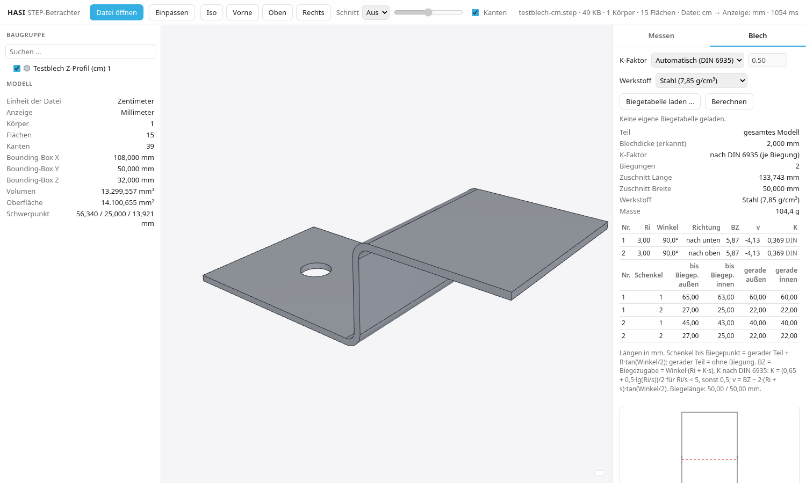

## Messen

Alle Werte werden exakt aus der B-Rep (OCCT) berechnet, nicht aus dem Dreiecksnetz, und immer in mm angezeigt.

**Messart wählen:** Schnellknöpfe und Auswahlliste stellen den gewünschten Wert an die erste Stelle. Der Hinweis nennt passende Elemente und die erforderliche Reihenfolge. Auswahlchips entfernen einzelne Elemente; Esc löscht die aktuelle Messung. Nachkommastellen ändern nur die Anzeige.

| Messart | Auswahl / Ergebnis |
| --- | --- |
| Radius / Durchmesser | Kreis, Bogen, Zylinder- oder Kugelfläche; kein erfundener Radius auf Freiform oder Kegel |
| Bogenlänge | Kreiskante oder Zylinderfläche, tatsächlicher Bogenwinkel auch über 180° |
| Sehnenlänge / Bogenhöhe | Offene Kreiskante; Endpunktverbindung bzw. Abstand Sehnenmitte–Bogenmitte. Keine willkürliche Sehne bei vollen Kreisen |
| Kantenlänge | Gerade oder gekrümmte Kante; wahre Kurvenlänge |
| Abstand / Winkel | Zwei geeignete Elemente; Abstandsmethode und Richtung unter Erweitert |
| Fläche / Umfang | Fläche mit Randlängen, Innenkonturen im Gesamtumfang enthalten; Kreisumfang bei geschlossener Kreiskante |
| Volumen und Oberfläche | Einen Körper anklicken; Warnung bei offenen Körpern beachten |
| Summe | Kanten oder Flächen ohne Strg nacheinander anklicken, schon ab zwei Elementen; erneuter Klick entfernt das Element |
| Winkel aus 3 Punkten | Schenkel 1 → Scheitel → Schenkel 2; 0° bis 180° |
| Kreis aus 3 Punkten | Drei unterschiedliche Punkte, nicht auf einer Geraden; definierter Kreis mit Radius, Ø und Mittelpunkt |

Explizite Flächen-/Körpermessungen sind immer sichtbar, unabhängig vom Flächen-Schalter unter Erweitert. Die Fangfilter gelten vorübergehend passend zur Messart. Grafische Bemaßung ist nur bei geeigneter Geometrie verfügbar; andere Werte lassen sich kopieren oder als Messprotokoll ausgeben. Beim nativen Laden darf bereits während der BREP-Vorbereitung gewählt werden; die Messung erscheint anschließend, sofern die Auswahl noch aktuell ist.

Entwicklungstests: `node tools/test-messarten.mjs`, `node tools/test-messauftraege.mjs`, `node tools/smoke-messarten.mjs` (Preview); native Prüfung über `KERN=native` und `HASI_KERN`. `smoke-native-messarten` prüft die verzögerte BREP-Bereitstellung, ist aber kein echtes OS-/WebView2-Pakettest.

- **Fangen** mit Hover-Vorschau und Fangsymbol: Ecke (Quadrat), Kantenmitte (Dreieck), Kreismittelpunkt (Kreis mit Kreuz), Kante, Fläche, Achse (gestrichelt; Zylinderflächen).
- **Ein Element:** Kantenlänge, Kantenmitte, Ø und R, Bogenwinkel, Bogenlänge, Umfang (gesamt und außen). Rundungen und Bögen zeigen Radius und Bogenlänge hervorgehoben.
- **Fläche anklicken (nur mm):** ebene Fläche → **Länge × Breite** in der Flächenebene (an der längsten Kante ausgerichtet), **Blechdicke** (Abstand zur gegenüberliegenden parallelen Fläche desselben Körpers, wenn erkennbar) und **Gesamthöhe** des Körpers senkrecht zur Fläche; Zylinder → **Durchmesser Ø**, **Radius R** und **Länge** entlang der Achse. Flächeninhalt (mm²), Volumen und Oberfläche erscheinen nur mit Messen › Erweitert › „Flächeninhalt, Volumen und Oberfläche anzeigen“ (Standard aus); die Masse im Blech-/Masse-Bereich bleibt.
- **Blech-Rundung (Ein-Klick):** Radius innen und außen, Biegewinkel, Blechdicke, Bogenlänge innen und außen, Schenkellänge innen und außen (gerader Anteil + R·tan(φ/2), bis zum virtuellen Knickpunkt), Außenmaß über die Biegung (Summe der äußeren Schenkellängen).
- **Zwei Elemente:** Abstand min., max. und Mitte–Mitte, jeweils mit ΔX/ΔY/ΔZ, Winkel Kante–Kante, Fläche–Fläche und Kante–Fläche, paralleler Abstand, Lochabstand Mitte–Mitte.
  - Der maximale Abstand wird über die Randkanten berechnet. Geraden werden über ihre Endpunkte ausgewertet, Kreise analytisch, andere Kurven per Abtastung mit Goldener-Schnitt-Verfeinerung.
  - Für Ebenen, Zylinder und Kegel ist das exakt, weil das Maximum auf dem Rand liegt.
- **Mehrfachauswahl** mit Strg/Umschalt: Gesamtlänge mehrerer Kanten, Gesamtfläche.
- **Bemaßungen** bleiben im 3D stehen. In der Liste lassen sie sich einzeln kopieren oder löschen, oder alle auf einmal.
- **Genauigkeit:** 0 bis 4 Nachkommastellen mit deutschem Komma.

Testsuite: `tools/test-messen.mjs` (läuft in CI). Sie prüft 58 Sollmaße am Messteil `testdaten/messteil.step` (erzeugt mit `tools/make-messteil.py`, CadQuery) und am Testblech mit einer Toleranz von 0,0001 mm. Der Headless-Test `tools/smoke-messen.mjs` erzeugt die Screenshots.

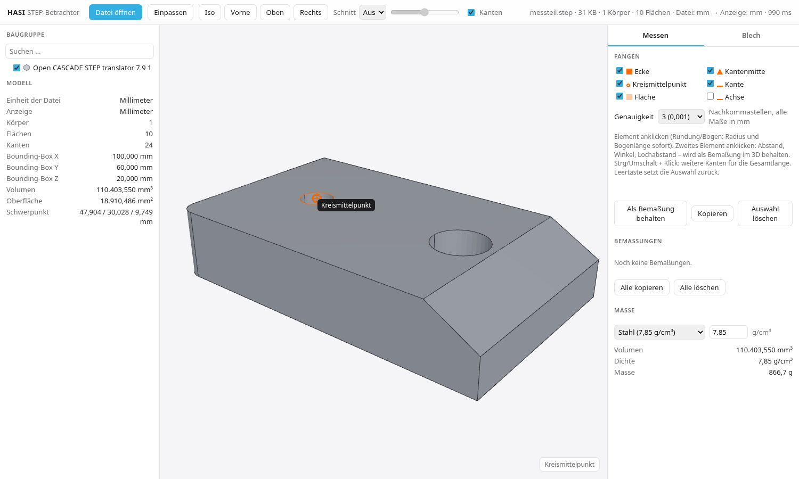 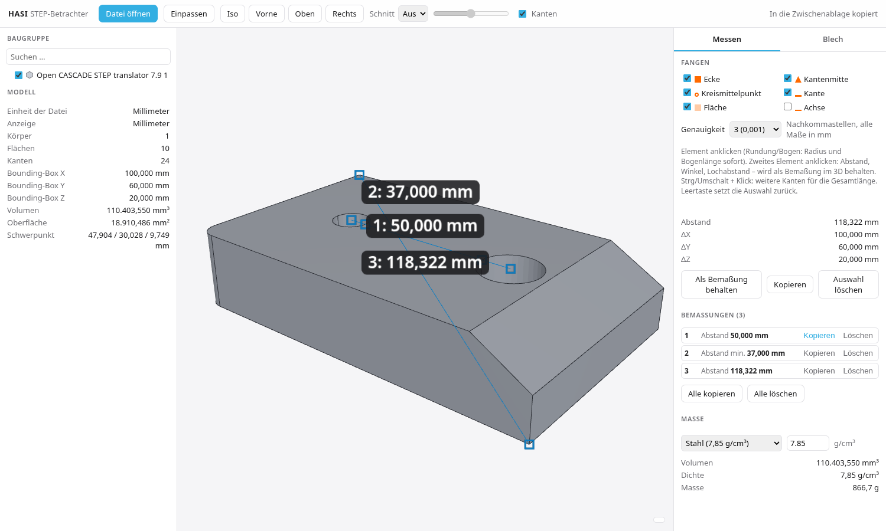 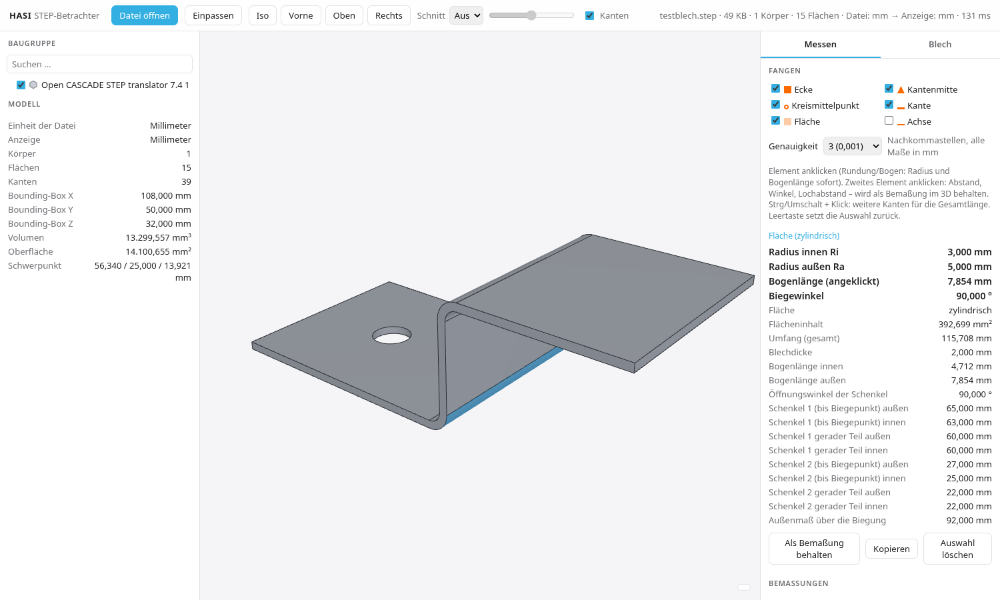

## Messen wie eDrawings

- **Start:** kein Werkzeugfeld offen, das Modell wird in die freie Fläche unter der Werkzeugleiste eingepasst (projizierter Hüllquader, mittig). Ein offenes Messen-Feld wird nicht wiederhergestellt.
- **Messen-Feld unten links** (höchstens 280 px breit): Messartwahl, Schnellzugriff, Auswahlführung, Nachkommastellen und Ergebnisse. In Automatik/Abstand zusätzlich Bogen-/Kreismessungen (Mitte zu Mitte, Mindestabstand, Maximalabstand). Abstandsmethode, Maßrichtung, Projektion, Fangen und Bemaßungsverwaltung liegen unter „Erweitert“ (zugeklappt). „Messen“ in der unteren Leiste öffnet und schließt das Feld. Die größere Werkzeugauswahl nutzt mehr Höhe; das Modell bleibt neben dem Feld frei.
- **Ein Klick auf eine Kante** zeigt den Wert direkt an der Kante, z. B. „Länge: 356,793 mm“; Bogen: Radius und Bogenlänge; Kreis: Durchmesser. Derselbe Wert steht unter „Ergebnisse“.
- **Zwei Flächen:** parallel → „Die zwei gewählten Elemente sind parallel.“, Normaler Abstand (lila, mit Lotlinie im 3D), Abstand (kürzester Abstand) und Delta X/Y/Z der kürzesten Strecke; nicht parallel → Mindestabstand und Winkel. Es bleibt keine Bemaßung stehen (wie eDrawings); andere Paare und „Nur Flächen“ (Q, wie ZW3D) bemaßen wie bisher.
- Im Messen wird die Verschieben-Triade nur gezeigt, wenn „Verschieben“ aktiv ist – sie verdeckt sonst Maßtexte.
- **Jedes Maß sagt, was es misst** – nie eine nackte Zahl: „Abstand (schräg) 63,25“, „Höhe (Z) 60,00“, „Horizontal (X) 20,00“, „ΔX/ΔY/ΔZ“, „Ø“, „R“, „Winkel“, „Fase“, „Kettenmaß“, „Basismaß“. Eigener Maßtext und Präfix bleiben möglich.
- **Zwei Punkte** (Ecke, Kantenmitte, Kreismittelpunkt): die Bemaßung folgt der Ansicht wie im CAD – im Bild fast senkrecht gewählt → **Höhe (Z)**, fast waagerecht → **Horizontal**, sonst **Abstand (schräg)**. Umschalter im Messen-Feld: **Auto / Ausgerichtet / Horizontal / Vertikal** (gilt sofort für die letzte Bemaßung). Die schräge Strecke und die Teilstrecken ΔX/ΔY/ΔZ tragen im 3D eigene Etiketten. Ergebnisse: zuerst **Höhe (ΔZ)**, dann Abstand, Delta X, Delta Y, Delta Z.
- **Gesamthöhe (Taste H oder Knopf „Gesamthöhe (H)“, auch beim Wählen eines Teils über den Baum):** exakt aus der B-Rep senkrecht zur Grundfläche (gleiche Regel wie Abmessungen D). Gezeigt werden **Gesamthöhe (Hüllquader)** – alles, was über Fuß- und Deckfläche hinausragt, eingeschlossen – und **Höhe Fläche–Fläche** von der untersten zur obersten ebenen Fläche senkrecht zur Höhe (wie „Normaler Abstand“ in eDrawings), dazu Länge und Breite, als senkrechte Maße rechts neben dem Teil mit Hilfslinien. Fläche anklicken richtet neu aus, H oder Esc beendet. Beim Ziehen bzw. bei gewählter linearer Bemaßung sperrt H wie bisher die Richtung horizontal.
- **Keine eigene Bemaßung-Schaltfläche mehr:** Messen und Bemaßung sind eins. Bemaßungen (Liste, Art wählen, Alle kopieren/löschen, als PNG/PDF, speichern/laden als `*.hasi3d.json`) stehen unter Messen › Erweitert; gespeicherte Bemaßungen lassen sich weiter laden. Menü Werkzeuge › „Bemaßungen (im Messen)“ öffnet die Stelle.
- Hover-Hinweis nur noch am Cursor (kein zweiter Hinweis unten rechts).

Geprüft durch `tools/test-edrw.mjs`, `tools/test-beschriftung.mjs` (CI, B-Rep, Beschriftungen, Gesamthöhe am synthetischen `testdaten/bock.step` aus `tools/make-bock-teil.py`), `tools/smoke-edrw.mjs` und `tools/smoke-hoehe-beschriftung.mjs` (headless, beide Marken, Bilder in `docs/edrw/`).

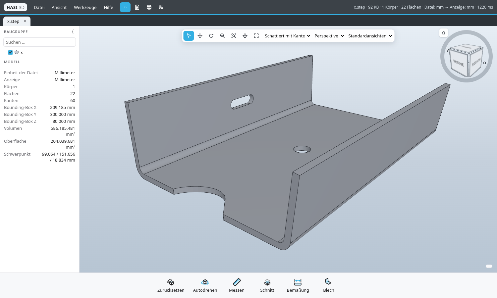 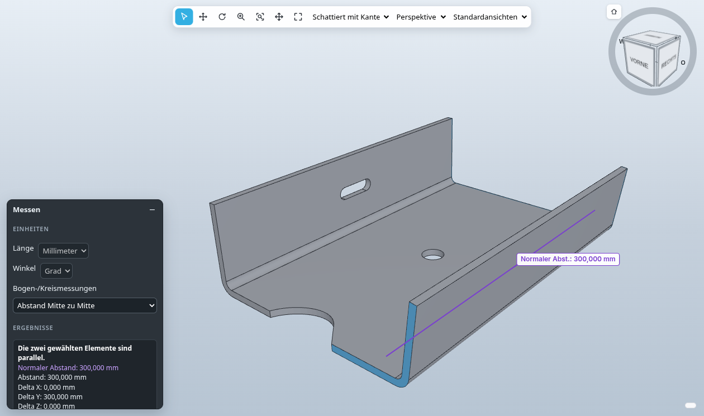 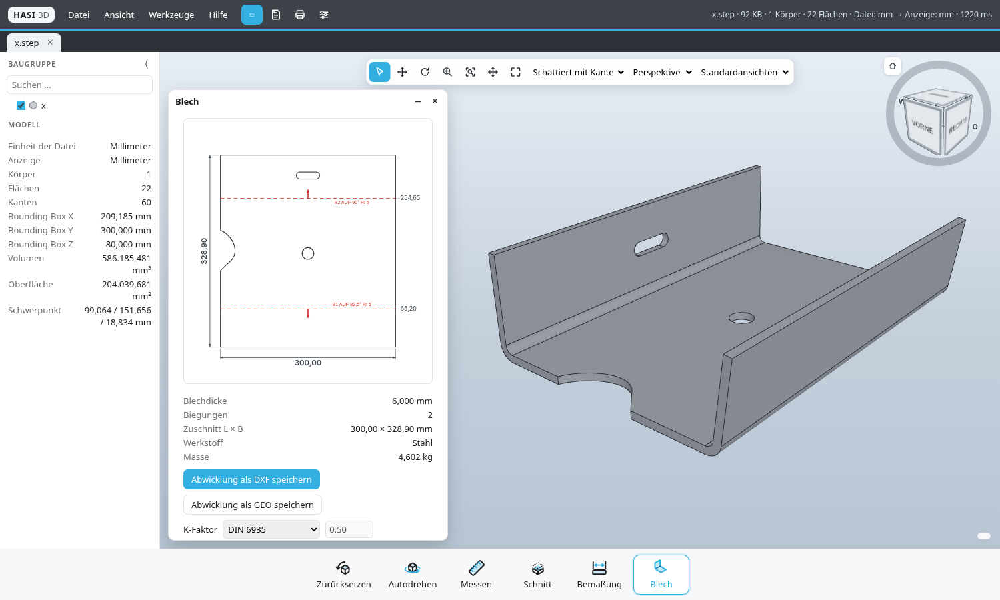

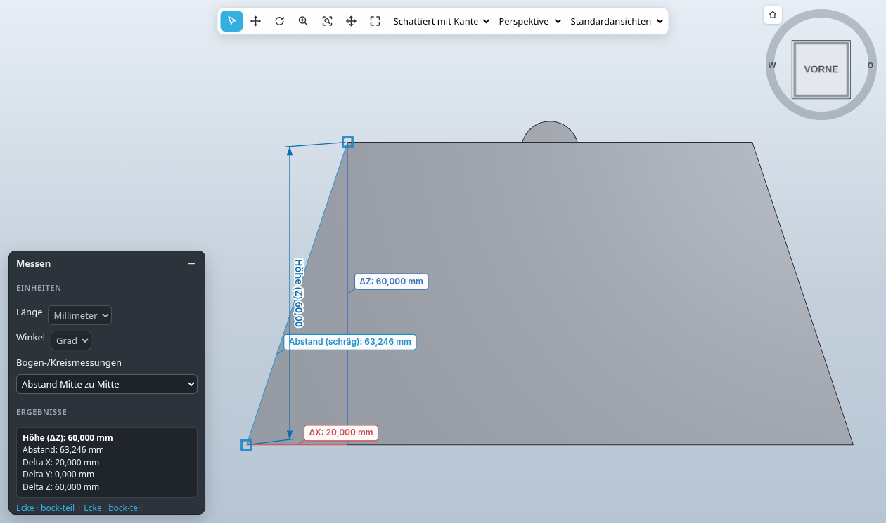 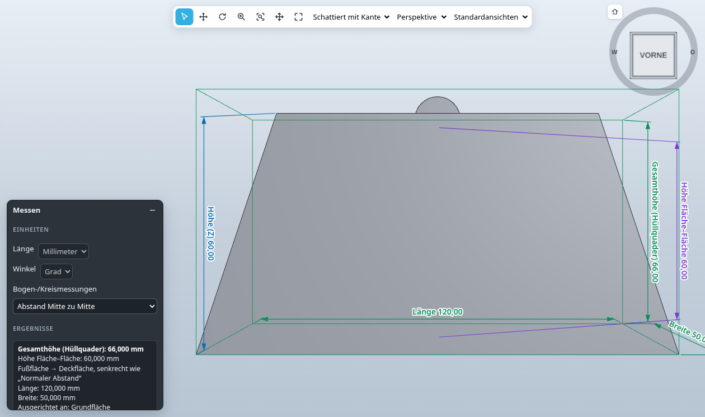

## K-Faktor und Biegetabelle

Im Blech-Panel wird der K-Faktor standardmäßig automatisch je Biegung aus dem Verhältnis Innenradius zu Blechdicke berechnet.

**Quelle der Formel:** DIN 6935:2011-10 „Kaltbiegen von Flacherzeugnissen aus Stahl“, Beiblatt 1 / Ausgleichswert:

- Korrekturfaktor k = 0,65 + 0,5 · lg(ri/s) für ri/s < 5, sonst k = 1
- neutrale Faser bei ri + k·s/2, also K = k/2 (K = 0,5 bei ri/s ≥ 5)
- Ausgleichswert v = φ · (ri + K·s) − 2 · (ri + s) · tan(φ/2) (für φ ≤ 90°; Biegezugabe BZ = v + 2·(ri + s)·tan(φ/2))

Umsetzung: `src/kfaktor.js`. Werkstoffe (Dichte für die Masse): Stahl 7,85, Edelstahl 7,90, Aluminium 2,70, Kupfer 8,96 g/cm³.

**Eigene Biegetabelle (CSV):** Spalten `s;ri;Winkel;v` oder `s;ri;Winkel;K` (Trennzeichen `;`, `,` oder Tab, Dezimalkomma erlaubt, Winkel optional). Passende Zeilen (s ±1 %, ri ±2 %, Winkel ±1°) haben Vorrang vor DIN 6935. Beispiel: `testdaten/biegetabelle-beispiel.csv` (Beispielwerte, keine Herstellerangaben).

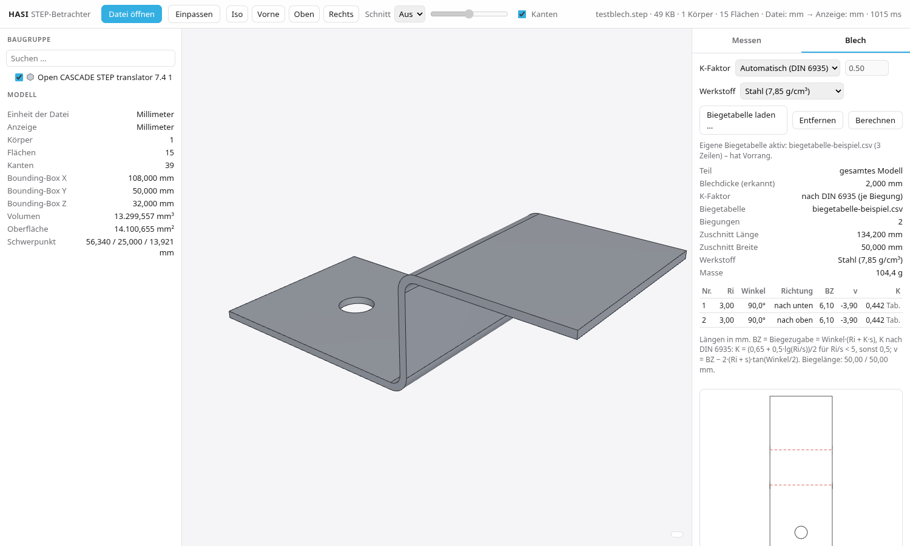

**K-Faktor „Trumpf-kompatibel“ (Standard in MS3D):** TruTops Boost rechnet nicht mit einem festen K-Faktor, sondern mit Biegeabzügen (BD) je Dicke, Radius und Winkel aus der Werkzeugdatenbank. Eine Trumpf-GEO desselben Teils zeigte für s 6 / Ri 6 (Gesenk EV W40, Oberwerkzeug R1): BD 11,1996 bei 90° (gleichwertig K 0,358) und BD 9,70327 bei 82,46° (gleichwertig K 0,312). DIN 6935 gibt K 0,325 für beide – ein einziger K-Faktor kann Trumpf daher nicht treffen, es braucht eine Tabelle je Winkel.

- Eingebaut sind diese Werte (`TRUMPF_TABELLE` in `src/kfaktor.js`). Zwischen zwei Winkeln wird der gleichwertige K-Faktor linear interpoliert, außerhalb gilt der nächste mit Hinweis.
- **Trumpf-GEO laden** (Blech → Details) übernimmt die BD-Werte aller Biegelinien einer GEO aus TruTops Boost (Dicke, DESIGN_BEND_RADIUS, Winkel, Biegeabzug) und hat Vorrang.
- Ohne Trumpf-Wert (andere Dicke oder anderer Radius) gilt DIN 6935 mit Hinweis.
- Mit diesen Werten stimmte der Zuschnitt des Kundenteils auf 0,0001 mm mit Trumpf überein (DIN 6935: −0,63 / +0,45 mm).
- Hasi 3D startet weiter mit DIN 6935; die Wahl bleibt gespeichert.

## Abwicklung

Die Abwicklung ist ein Baum über den Flächengraphen einer Blechseite. Sie startet an der größten ebenen Hautfläche und geht nur über tangentiale gerade Kanten weiter: Ebene ↔ Zylinder, Zylinder ↔ Zylinder (Biegung direkt an Biegung) und geteilte ebene Flächen. Dadurch werden Laschen in mehrere Richtungen und Eckfreischnitte unterstützt. Biegungen werden über die neutrale Faser abgewickelt (Biegezugabe nach DIN 6935, Biegetabelle oder manueller K-Faktor).

Statt einer stillschweigend falschen Kontur erscheint eine **rote Warnung**, und der DXF-Export wird gesperrt, wenn mindestens eines davon zutrifft:

- Die Flächenbilanz geht nicht auf: Die abgewickelte neutrale Fläche liegt unter 97 % von Volumen/Blechdicke.
- Es gibt geschlossene Ecken: Kanten zwischen zwei Hautflächen, die außerhalb des Baums in 2D nicht deckungsgleich sind (Eckfreischnitt fehlt).
- Es gibt scharfkantige Biegungen ohne Radius.
- Es gibt nicht abwickelbare Flächen (Kegel, Kugel, Torus, Freiform).
- Die Kontur überschneidet sich selbst.

Testteile (selbst erzeugt mit `tools/make-abwicklung-teile.py`, CadQuery):

- S-Profil (Biegung an Biegung)
- Wanne mit vier Laschen und Eckfreischnitten
- Wanne ohne Eckfreischnitte
- Winkel mit Senkung
- Kuppel

Geprüft durch `tools/test-abwicklung.mjs` (CI, Sollmaße) und `tools/smoke-abwicklung.mjs` (headless).

**Blech-Feld:** oben die Abwicklung mit Maßen (Zuschnitt Länge × Breite, Lage der achsparallelen Biegelinien ab der unteren bzw. linken Kante), darunter Blechdicke, Biegungen, Zuschnitt, Werkstoff und Masse. Biegetabelle, Schenkel, Formeln und Einstellungen liegen unter „Details“.

**Freiform-Stirnflächen:** schräg geschnittene Biegungsenden liegen in manchen Dateien als B-Spline-Fläche mit Dicke-Kante vor. Sie gehören zum Rand, nicht zur Blechseite, und sperren die Abwicklung nicht mehr (Hinweis statt Fehler). Andere nicht abwickelbare Flächen sperren weiter.

**Lage wie Trumpf:** Standard ist „wie Trumpf“: die lange Seite senkrecht (Y), +90° gedreht, Ursprung links unten. „wie konstruiert“ lässt die Lage der festen Fläche.

**Abwicklung als GEO speichern** (Trumpf GEO 1.03 wie TruTops Boost, `src/geo.js`): Außenkontur und Innenkonturen aus Linien, echten Bögen und Kreisen, Biegelinien mit Öffnungswinkel (− = AB, + = AUF), Radius und Biegeabzug, Schnittlänge. DXF und GEO werden über den Speichern-Dialog geschrieben; fehlt die Endung, wird `.dxf` bzw. `.geo` angehängt. Geprüft durch `tools/test-trumpf-geo.mjs` (CI): Schreiben, neu Einlesen, Ausdehnung, Konturen, Biegelinien, Fläche, Schnittlänge, ezdxf-Audit.

Speichern (Desktop): Rust schreibt die GEO als ANSI (Windows-1252) mit CRLF, prüft danach die Dateigröße auf der Platte und meldet „GEO gespeichert: … (n Bytes)“; ein leerer Inhalt legt keine Datei an, sondern meldet es. Der Abschnitt #~11 hat dieselben 20 Zeilen wie die GEO aus TruTops (vorher fehlte eine Leerzeile, ein zeilengenauer Leser fand dann keine Geometrie). Freistich-Ecken, die über eine Biegezone laufen, werden als echte Bögen (≤ 0,01 mm Abweichung) statt als Polylinie geschrieben – in DXF und GEO. CI: `tools/smoke-geo-speichern.mjs` (Klick in der Oberfläche) → `cargo test geo_aus_der_oberflaeche_speichern` (Schreibweg der App, auch unter Windows) → `tools/geo-pruefen.mjs` (Konturen, Biegungen, Ausdehnung).

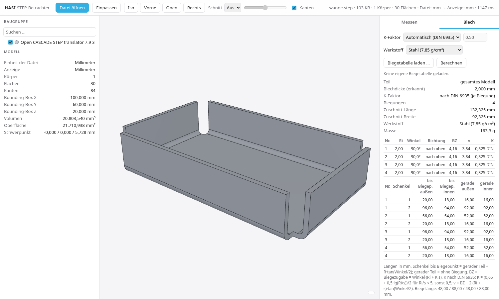 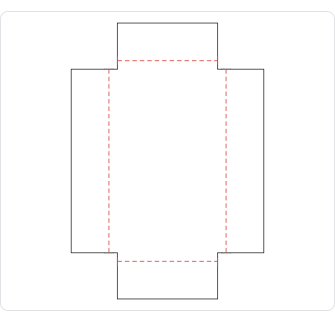 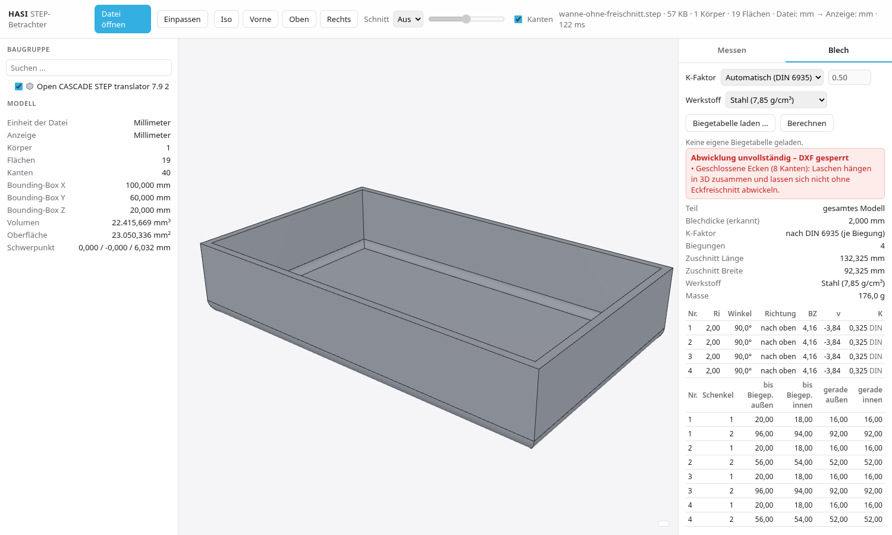

## Biegetabelle exportieren

Im Blech-Panel stehen die Knöpfe **„Biegetabelle als PDF“** und **„Biegetabelle als Excel (XLSX)“**. Beide sind gesperrt, solange die Abwicklung unvollständig ist.

- **Inhalt:**
  - Kopf: Teil, Datum, Blechdicke, Werkstoff, K-Faktor, Zuschnitt (Länge × Breite), Masse
  - je Biegung: Nr. (Reihenfolge der Abwicklung, keine Biegefolgeplanung), Winkel, Ri, Richtung, Lage der Biegelinie im Zuschnitt (Ursprung linke untere Ecke wie im DXF; im XLSX zusätzlich x1/y1/x2/y2), Biegelänge, BZ, v, K mit Quelle
  - Schenkellängen bis Biegepunkt und gerader Teil, jeweils innen und außen
  - im PDF zusätzlich eine Vorschau der Abwicklung mit nummerierten Biegelinien
- **Format:** PDF A4 quer, deutsch, mit jsPDF + jspdf-autotable (MIT). XLSX mit write-excel-file (MIT); Zahlen werden als Zahlen gespeichert, deutsches Excel zeigt sie mit Komma.
- **Speichern:** In der Desktop-App über den System-Dialog (Rust-Befehl `save_bytes`), im Browser als Download.

Tests: `tools/test-export.mjs` (CI, prüft PDF-Text, XLSX-Inhalt und die Lage der Biegelinien gegen Sollwerte) und `tools/smoke-export.mjs` (headless, Knöpfe im Blech-Panel).

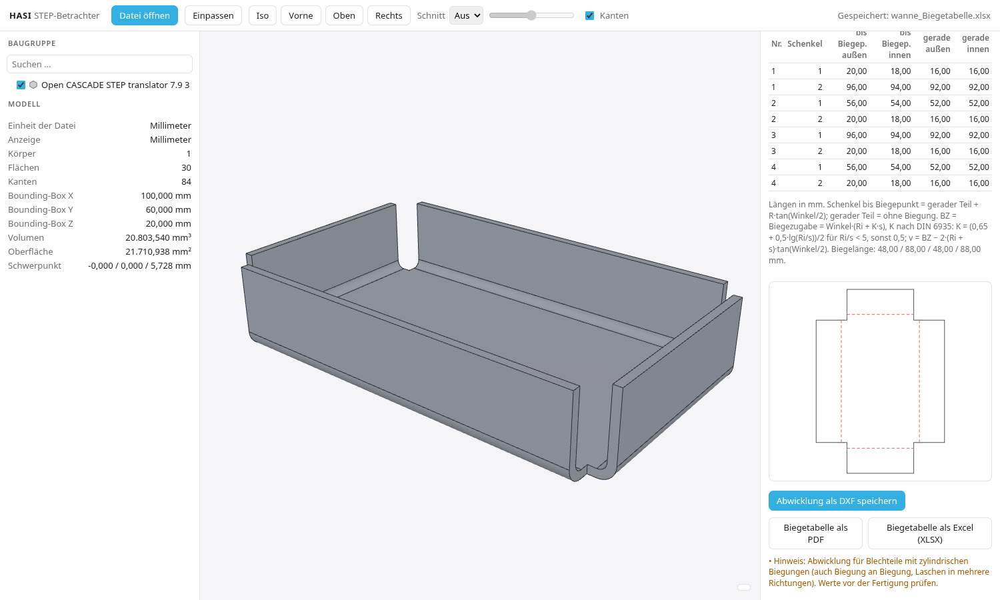 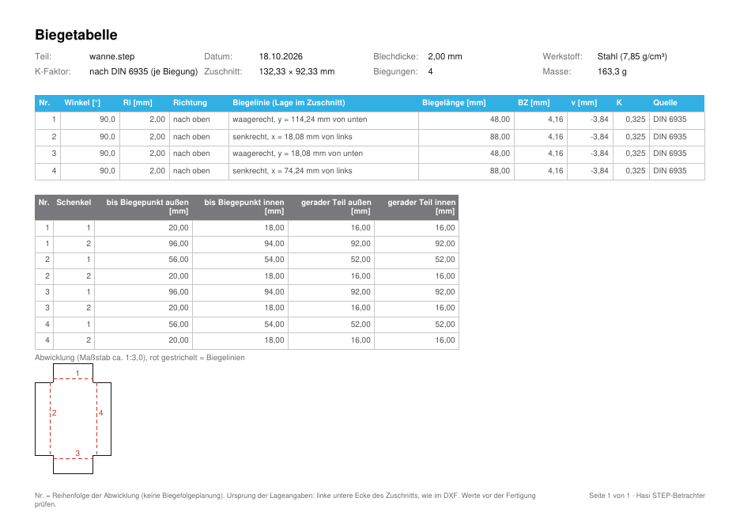

## Nativer Kern (Desktop-App, ab feat/nativer-kern)

Öffnen über Menü/Symbol, Doppelklick und Drag & Drop verwendet denselben pfadbasierten Ladeweg mit Zwischenspeicher. Dateien lassen sich im gesamten Fenster ablegen, auch über Baum und Bedienfeldern. Windows-Pfade mit Umlauten, ß, türkischen oder anderen Unicode-Zeichen bleiben bis zum OCCT-Kern erhalten. Dateiwechsel werden serialisiert; ein neuer Auftrag wartet auf die Messdaten des vorherigen Modells, und mehrere gleichzeitig wartende Aufträge werden auf den neuesten reduziert.

Regressionstests: `node tools/test-datei-oeffnen.mjs`, `node tools/smoke-drop.mjs`, `node tools/smoke-datei-oeffnen.mjs` und `HASI_KERN=<programm> node tools/test-unicode-kern.mjs` (synthetische Testdateien, einschließlich Unicode-Import und -Export).

Die Desktop-App lädt STEP-Dateien mit einem nativen OCCT-Kern (`kern/hasi_kern.cpp`, Programm `hasi-kern`), der als Sidecar neben der App liegt. Der WASM-Kern bleibt als Rückfall (Browser, fehlender Sidecar, Fehler im nativen Lauf) und für das Messen. Doppelklick und Ziehen ins Fenster übergeben den Dateipfad an `hasi-kern`; die Originaldatei wird dabei nicht gelöscht. Ein zweiter Doppelklick öffnet die Datei im bereits laufenden Fenster.

- **Ablauf:** STEP parsen → Produktstruktur und Baugruppen-Lagen direkt aus der STEP-Datei (CONTEXT_DEPENDENT_SHAPE_REPRESENTATION) → Blatt-Teile parallel übersetzen, Mehrkörper-Teile je Körper → Unikate parallel tessellieren und indizieren (gleiche Reihenfolge der Flächen/Kanten wie im WASM-Kern).
- **Ausgabe:** `modell.bin` (Netze, Flächen-/Kanteninfo, Baum, Lagen) für die sofortige Anzeige und `modell.brep` (Unikate als BREP). Das BREP wird danach im Hintergrund in den WASM-Kern geladen; Flächen und Kanten eines Teils werden beim ersten Messen indiziert und gegen die nativen Zahlen geprüft. Gemessen wird also weiter mit demselben JS/WASM-Code.
- **Threads:** Das Parsen ist in OCCT nicht threadsicher und läuft nacheinander; bis zu 3 Leser übersetzen parallel, Tessellierung auf allen Kernen.
- **Prüfung:** `hasi-kern <datei> <ordner> --pruefen` vergleicht alle Instanzen (Welt-Bounding-Boxen) mit dem seriellen OCCT-Transfer. Unbekannte Strukturen → serieller Transfer (`--seriell`).
- **Tests:** `KERN=native node tools/test-*.mjs` lädt über den nativen Kern (`kern/build/hasi-kern`); `node tools/smoke-kern.mjs` prüft den nativen Ladepfad im Browser mit simulierten Tauri-Aufrufen.
- **Bauen:** `tools/occt-bauen.sh <ordner>` baut OCCT 7.8.1 ohne Fremdbibliotheken, dann `cmake -S kern -B kern/build -DCMAKE_PREFIX_PATH=<ordner> && cmake --build kern/build`. In CI mit Cache (Schlüssel: OCCT-Version und Betriebssystem); `tools/kern-paket.py` legt Programm und Bibliotheken für Tauri bereit. Windows: DLLs neben `hasi-kern.exe`. macOS universal: Bibliotheken unter `Contents/Resources/kern`, gefunden über `@rpath`/`@loader_path`.
- **Abschalten:** `localStorage.kern = 'wasm'` in der App oder Umgebungsvariable `HASI_KERN=aus`.
- **Dateizuordnung:** `.step` und `.stp` über `bundle.fileAssociations` (NSIS, MSI, Info.plist). Die MSI-Vorlage `src-tauri/windows/main.wxs` entspricht Tauri-CLI 2.12.3; die Programmkennung ist `HasiStep` bzw. `SickingerStep`, weil der Produktname Leerzeichen enthält und sonst keine gültige WiX-Id wäre.
